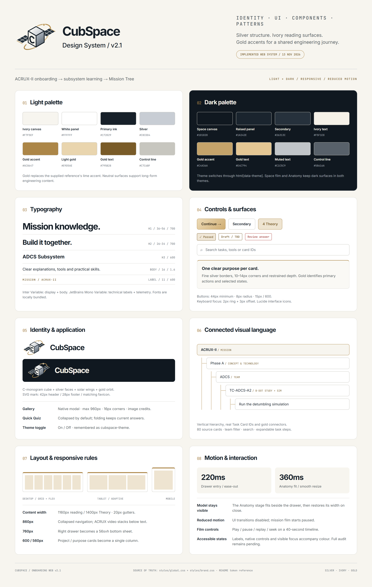

# CubSpace Onboarding Web v2.1

An English onboarding prototype for new ACRUX-II engineers, connecting mission context, subsystem learning and the separate Mission Tree application.

## Run locally

Requires Node.js **22.13 or later**.

```powershell
cd frontend
npm ci
Copy-Item .env.example .env.local
npm run dev
```

Open http://localhost:3000. Set `VITE_MISSION_TREE_URL` in `.env.local` to the Mission Tree application's root origin. The example `http://localhost:5173` requires that separate application to be running. Leave the variable empty to disable external navigation. Restart Vite after changing configuration; production configuration requires a rebuild.

## v2.0 to v2.1: complete change record

### Page structure and navigation

The learning flow is now **Start → About → ACRUX-II → Theory → Mission Tree → Launch**. Every page is accessible without passing a quiz. The previous Home/Story/Admin screens and their sequential quiz-lock system have been replaced.

Direct routes use `#start`, `#about`, `#acrux`, `#theory`, `#mission-tree` and `#launch`. Empty or unknown hashes show Start. Browser Back/Forward navigation is supported. The old `/admin` and `?admin=1` unlock flows are no longer implemented.

### Identity, layout and themes

- Silver, ivory and gold replace the previous accent palette, following the supplied CubSpace design-system references.
- Inter is the display/body typeface; JetBrains Mono labels identify technical metadata.
- A new vector CubeSat mark combines a silver chassis, solar panels, a C monogram and a gold orbit. Header, footer and favicon use the updated identity.
- Buttons, cards, borders, status tags, navigation and responsive layouts share the new tokens.
- A header **Dark mode On/Off** toggle switches between ivory/light and charcoal/dark surfaces and persists across reloads.
- The film and model viewer retain dark space backgrounds in both themes. Reduced-motion settings are respected.

### Start: one continuous mission

The landing page is a deterministic **40-second 3D mission film**: Launch → Ascent → Deployment → Detumble → Antennas → Contact. It includes play, pause, replay, a seek timeline, captions, illustrative telemetry and a completion state. Playback starts automatically except for reduced-motion visitors.

The antenna fix normalises the imported satellite against its chassis rather than the deployed antenna bounds, hides the static antenna rods, attaches the animated replacements to the actual model spool positions, and extends them outward without moving their roots. Geometry and timing remain conceptual rather than verified Falcon CAD or flight simulation.

### About: MSP and CubSpace

- Separate MSP and CubSpace introductions, each with **Our Vision / Our Mission**. CubSpace statements describe this project's learning and engineering purpose.
- Stacked separator lines were replaced with clearly grouped purpose cards.
- MSP history remains based on public sources, with later history explicitly pending the Jenny History PPT.
- Four selectable project cards: **01 ACRUX-2, 02 Humanoid, 03 Animatronics, 04 CubSpace Project**.
- Each card opens an accessible image gallery with captions, close/Escape support and image navigation when multiple images are available.
- MSP galleries use official project-page photographs and source credits. The ACRUX photograph is labelled as ACRUX-1 flight heritage, not new ACRUX-II hardware. CubSpace shows its mark and current application screenshots.

### ACRUX-II: introduction and video

Mission background, facts, success steps, operations and technology demonstrations are presented together. The supplied [mission video](https://www.youtube.com/watch?v=cCGppiJOoZY) sits **to the right of the introductory text on desktop**, stacking on mobile. It requests **muted autoplay on page entry**, retains player controls and provides a YouTube link. Playback availability depends on YouTube and browser autoplay policy.

### Theory: anatomy and subsystem subpages

- Central interactive 1U viewer: rotate, zoom, select, explode/assemble and reset.
- All six subsystem buttons and model selection open a **right-side description drawer**, preserving the main page.
- Opening the drawer smoothly fits the Anatomy stage into the available left space; closing restores its width. Mobile uses a bottom sheet with a compact model stage above it.
- Drawers contain role, objective, tasks, required tools/skills, video, model items, references and learning outcome. Close and Escape are supported.
- **Quick Quiz is collapsible**, initially closed. Answers survive collapsing/reopening within the same subsystem; switching subsystems resets the current answer UI.
- BOX, EPS and ADCS are the initial teaching priorities. OBC/FSW, COMMS and PAY remain labelled drafts without quizzes pending team review.
- All answers must be selected before checking; all must be correct to record a pass. Retry clears answers but keeps an existing pass.
- Subsystem tutorial clips load on request, use the supplied clip-sheet IDs/windows and distinguish illustrative tutorials from flight hardware. The ADCS clip window remains unselected.

### Mission Tree: interactive vertical preview

The former statistics and horizontal Phase tiles are replaced by a **vertical, interactive Mission → Phase → Team → Task Card → Tasks tree**. Its 80 cards and task steps are imported from `frontend_v3/src/features/feature_a/pmCards.ts` in the supplied Mission Tree ZIP (CUB-TM-00-1U R6).

Features include Phase/team expansion, expand/collapse all, team filtering, card/tool/text search, matching-card counts, empty results and expandable real task steps. Configured builds link individual cards to the separate Mission Tree app. Manuals and executable workshops continue there; this preview does not submit work or record engineering approvals.

### Launch: external handoff

Choose a team and a destination: the whole tree, a team workflow or the ADCS detumbling workshop. An informational readiness checklist shows film/quiz progress without blocking access.

URL examples:

- `https://mission-tree.example/?from=onboarding&team=ADCS#/workflow/ADCS`
- `https://mission-tree.example/?from=onboarding&team=ADCS#/A/TC-ADCS-A2/workshop/A2.1`

The external app's first Admin/Junior selection may replace an incoming deep link; verify re-entry after that choice. Query parameters are metadata for future integration, not authentication or guaranteed shared state.

## Applied design system: silver / ivory / gold

The supplied CubSpace identity and Design System v1.0 images guide the modular satellite identity, clean sans-serif hierarchy, structured cards and connected mission diagrams. This implementation adapts the reference's lime accents to **gold**, pairs **silver structure with ivory reading surfaces**, and retains charcoal for space visualisations. The table below describes the implemented CSS rather than an unimplemented fixed reference scale.

[Download the design-system PNG](docs/design-system-v2_1.png)



### Colour tokens and roles

| CSS token / role | Light | Dark |
| --- | --- | --- |
| --ink / page canvas | #F7F5EF | #101820 |
| --panel / raised surfaces | #FFFFFF | #1A242E |
| --panel2 / secondary surfaces | #EEECE6 | #26313C |
| --text / primary text | #172029 | #F5F1E8 |
| --muted / body support text | #535B62 | #C1C5C9 |
| --faint / metadata | #687078 | #A7AFB7 |
| --line / separators | #DEDDD7 | #303B46 |
| --control-line / control borders | #C7C6BF | #58616A |
| --silver / structural accent | #C8CDD4 | #C8CDD4 |
| --gold / accent borders | #AC8647 | #C4A36A |
| --gold-light / light gold fill | #E9D5AE | #E9D5AE |
| --gold-dark / accent text | #795B28 | #E4C794 |
| --grip / keyboard focus | #8A682D | #E4C794 |

Primary actions use a #EDDBB7 ? #CFAD72 gold gradient with dark #272116 text. Selected navigation and team choices use subtle gold-tinted surfaces. Success indicators also use the gold family, with checkmarks/text conveying their meaning. Light-theme caution and error tokens are #85602B and #AE443C; errors retain the red token in dark mode.

Subsystem accents are restrained identifiers: BOX #8B775D, EPS #9B7437, ADCS #8E6B39, OBC #67727F, COMMS #657574 and PAY #9A814E. Model materials remain metallic silver, dark solar cells and gold/copper details; tutorial imagery retains its source colours.

### Typography

| Use | Implemented rule |
| --- | --- |
| Display and body | Inter Variable, locally bundled |
| Technical labels / telemetry | JetBrains Mono Variable, locally bundled |
| Page H1 | clamp(36px, 4.5vw, 56px), weight 700, line-height 1.12, tracking -0.055em |
| Section H2 | clamp(26px, 3vw, 34px), weight 700, tracking -0.04em |
| Subsystem drawer H2 | clamp(27.2px, 3vw, 38.4px) |
| H3 | weight 600, line-height 1.25; size follows the component |
| Body | 16px, line-height 1.6 |
| Lead paragraph | clamp(17px, 1.6vw, 20.8px), line-height 1.5 |
| Eyebrow | 11px technical label, weight 600, uppercase, tracking 0.14em |
| Standard button | 15px, weight 600 |

### Logo and iconography

The scalable mark combines a C-monogram cube, silver faces, dark solar-panel wings and a gold orbital stroke/dot. The header pairs it with the CubSpace wordmark; the footer uses a smaller lockup and the favicon uses the mark alone. Header/footer mark heights are 42px/28px. The design reference's lime is not used in the mark.

Logo source: `frontend/src/assets/cubspace-mark.svg`; favicon: `frontend/public/favicon.svg`; shared renderer: `BrandLogo.tsx`. Interface icons use Lucide React: navigation arrows, expand/collapse chevrons, close, search, play/pause/replay and sun/moon. Use icons alongside labels or accessible names, not colour alone.

### Components and surfaces

- Standard actions: minimum 44px height, 18px horizontal padding, 8px corner radius. Large calls to action are 56px high; the compact theme toggle is 38px high.
- Reading/project cards: fine neutral borders, white or dark raised surfaces, typically 10?14px radii and restrained shadows. About purpose cards use a 2px gold top border.
- Navigation: numbered six-step progression with gold connectors/selection, a sticky 76px header and a mobile menu.
- Gallery: native modal dialog, maximum 960px width, 16px radius, dimmed/blurred backdrop, contained imagery, captions, credits and thumbnails when available.
- Theory drawer: independently scrolling right panel, maximum min(720px, 54vw), close control and Escape support. Quick Quiz uses native details/summary and retains answers while folded.
- Mission Tree: gold mission root and vertical connector, nested Phase/team controls and expandable card details. Search and team filtering operate on the actual 80-card dataset.
- Keyboard focus: 2px focus ring with 3px offset; accessible names and native controls accompany visual states. This does not represent a completed accessibility audit.

### Layout, responsiveness and motion

Reading pages cap at 1160px and Theory at 1400px, with 20px side gutters and fluid vertical spacing. Layouts use CSS Grid/Flex rather than a global fixed twelve-column grid. Project cards use two columns and become one at 600px. The main navigation collapses at 860px; the ACRUX intro/video also stacks at that width. Purpose cards stack at 560px.

At 760px and below, the subsystem panel becomes a bottom sheet occupying 56svh. The Anatomy stage is fitted above it. On desktop the stage shrinks into the left space, preserving the full model and subsystem buttons; closing restores its width. The gallery remains within the viewport and its images use object-fit: contain.

Drawer entry takes 220ms. Anatomy width/height fitting takes 360ms, with cubic-bezier(0.22, 1, 0.36, 1) on width. Reduced-motion CSS disables transitions/animations and the mission film begins paused. Subsystem navigation buttons remain stationary.

Theme state is applied through `html[data-theme]` and persisted as `cubspace-theme`. Light is the default. The film and Anatomy viewer keep locally scoped dark tokens in both modes. Base tokens/shared controls live in `styles/global.css`; active brand/theme/component overrides live in `styles/brand.css`, imported after the page styles. Update those sources together with this documentation and the PNG when changing the system.

## Development specification

React 19, TypeScript 5.9, Vite 8, Three.js 0.184, Lenis, Lucide and plain CSS. Inter replaces the earlier Archivo/Inter Tight font dependencies. The obsolete Tailwind PostCSS configuration was removed. No backend, database or login is included.

| Location | Responsibility |
| --- | --- |
| frontend/src/pages/OnboardingPage.tsx | Assemble the six pages |
| frontend/src/features/course/ | Navigation and learning progress |
| frontend/src/features/start/film.ts | Continuous mission scene and antenna animation |
| frontend/src/features/about/ | MSP/CubSpace content and project galleries |
| frontend/src/features/acrux/ | Mission overview and autoplay video |
| frontend/src/features/theory/ | Viewer, subsystem drawers, tutorials and quizzes |
| frontend/src/features/mission-tree/ | Interactive tree data, preview and external URL contract |
| frontend/src/hooks/useTheme.ts | Theme selection and persistence |
| frontend/src/styles/ | Shared tokens and responsive page/theme styles |
| frontend/public/images/projects/ | Credited project photos and application screenshots |

Local storage keys: `cubspace-onboarding-progress-v2_1` stores film completion, quiz passes and team; `cubspace-theme` stores the selected theme. Storage failure falls back to in-memory use. Old-version progress is not migrated. No state is shared with the external app through storage.

## Commands and validation

Run in `frontend/`:

| Command | Purpose |
| --- | --- |
| npm run dev | Start development server |
| npm run lint | oxlint checks |
| npm run typecheck | TypeScript checks |
| npm run build | Type check and production bundle |
| npm run preview | Serve production bundle locally |
| npm run format | Format source |

Lint and production build pass. Chromium checks cover desktop/mobile rendering, theme persistence, galleries, subsystem drawers, quiz toggling, search/filter/task expansion and no-result behaviour. A large JavaScript bundle warning remains. See the [verification record](docs/onboarding-v2_1-verification.md) for exact coverage and remaining checks.

## Lead developer follow-up

| Item | Outstanding review | Meeting owner |
| --- | --- | --- |
| Start | Falcon CAD fidelity and educational sequence review | DH, HD |
| About | Jenny History PPT and later MSP history | TH |
| ACRUX-II | Reconcile public camera description with meeting Camera TBD | TH |
| Theory | BOX/EPS/ADCS content review; remaining draft quizzes | JY |
| Videos | Frame-by-frame selection and ADCS timestamps; actual external playback | TH |
| Mission Tree | Production origin, first-visit deep links and Junior ADCS workflow | DH |
| UI | Full keyboard, blocked-storage, WebGL-failure and cross-browser review | DH, HD |
| Approval | Internal/Board review and Junior workflow sign-off | Team |

Meeting checkpoints: 21 November internal review, 24 November 18:00 Board review, 27 November onboarding day. The team confirms dates and approvals.

Master requirements: Standup-NOV-WK2-20261113063258.md. Supporting references include CubeSat_Anatomy v1.0.1, the supplied YouTube clip sheet and Mission Tree prototype. Public sources: [MSP About](https://www.melbournespace.com.au/who-we-are), [MSP Projects](https://www.melbournespace.com.au/projects). Original source archives and the historical Claude session were read only and are not included in this repository.

See [detailed specification](docs/onboarding-v2_1-spec.md), [quiz authoring](docs/quiz-authoring.md) and [verification](docs/onboarding-v2_1-verification.md). DESIGN.md and docs/engineering-review.md retain earlier design/review history and are not v2.1 approval records.
